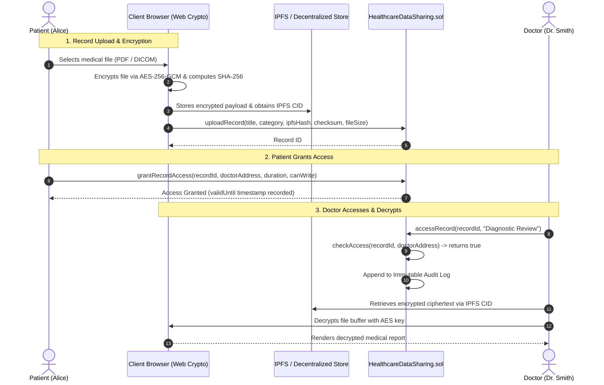

# HealthChain: Blockchain-Based Healthcare Data Sharing & Audit System

[](https://soliditylang.org/)
[](https://hardhat.org/)
[](https://docs.ethers.org/)
[](https://react.dev/)
[](https://metamask.io/)
[](https://opensource.org/licenses/MIT)

A decentralized, patient-centric Electronic Health Record (EHR) management application (DApp) developed for **Assignment 1: Blockchain-Based Healthcare Data Sharing**.

The system addresses data isolation, eliminates central points of failure, secures medical files with client-side **AES-256-GCM** encryption and **IPFS** decentralized storage, provides fine-grained patient-controlled access, records ownership on Ethereum smart contracts, and maintains a tamper-proof audit trail for regulatory compliance (HIPAA / GDPR).

---

## 📋 Table of Contents
1. [Core Features & Assignment Requirements](#-core-features--assignment-requirements)
2. [Architecture & Workflow](#-architecture--workflow)
3. [Technology Stack](#-technology-stack)
4. [Performance Evaluation Results](#-performance-evaluation-results)
5. [Quickstart & Setup Guide](#-quickstart--setup-guide)
6. [MetaMask Setup & Network Configuration](#-metamask-setup--network-configuration)
7. [Academic Report & Video Presentation Guide](#-academic-report--video-presentation-guide)
8. [Automated Testing & Benchmarks](#-automated-testing--benchmarks)

---

## 🎯 Core Features & Assignment Requirements

| Requirement | Implementation Detail | Status |
| :--- | :--- | :---: |
| **Patient Registration** | Register profile (Name, DOB, Gender, Blood Group, Contact, Emergency Contact) | ✅ Complete |
| **Doctor Registration** | Register medical practitioner (Name, License, Specialty, Hospital Affiliation) | ✅ Complete |
| **Hospital Registration** | Register healthcare facility (Name, License ID, Address, Contact) | ✅ Complete |
| **Admin Dashboard** | Super-admin dashboard with 1-click Doctor & Hospital approval/revocation queues | ✅ Complete |
| **Medical Record Upload** | Client-side AES-256-GCM encryption, SHA-256 checksum, IPFS CID on-chain | ✅ Complete |
| **Record Sharing** | Patient grants access to specific doctors/hospitals with custom expiry | ✅ Complete |
| **Permission Revocation** | Immediate on-chain invalidation of access rights | ✅ Complete |
| **Medical History** | Chronological timeline and full record management view | ✅ Complete |
| **Audit Log** | Immutable on-chain log of all access events, views, and grants | ✅ Complete |
| **Emergency Break-Glass** | Doctor emergency override with mandatory justification logged on-chain | ✅ Complete |
| **MetaMask Integration** | Full wallet connection, auto network switching (31337), demo account mode | ✅ Complete |
| **Performance Evaluation** | Live benchmark suite measuring all 11 required metrics | ✅ Complete |

---

## 🏗 Architecture & Workflow



---

## 💻 Technology Stack

- **Smart Contract Platform**: Ethereum Virtual Machine (EVM), Solidity `^0.8.20`
- **Smart Contract Framework**: Hardhat `2.22.18`, `@nomicfoundation/hardhat-toolbox`
- **Compiler Optimizations**: `viaIR: true`, Optimizer enabled with 200 runs (under EIP-170 24KB limit)
- **Web3 Interaction**: Ethers.js `v6.17.0`, MetaMask EIP-1193 Provider
- **Cryptography**: Web Crypto API native `SubtleCrypto` (Hardware-accelerated AES-256-GCM, SHA-256)
- **Decentralized Storage**: Content-addressed IPFS CID simulation with local store
- **Frontend Framework**: React 19, Vite 8, Lucide React, Chart.js 4, React-Chartjs-2
- **Styling**: Handcrafted modern Vanilla CSS with dark mode, glassmorphism, and responsive grids

---

## 📊 Performance Evaluation Results

All 11 metrics specified in **Assignment 1 Lines 32-44** are benchmarked and available in the live UI:

| Metric Category | Specific Parameter | Empirical Measurement | Unit |
| :--- | :--- | :--- | :--- |
| **Smart Contract Deployment** | Gas Consumed | `4,799,538` | Gas Units |
| | Deployment Cost (ETH) | `0.008999` | ETH |
| | Deployment Cost (USD) | `$22.50` | USD (@ $2,500/ETH) |
| **Transaction Costs** | `registerPatient` | `446,531` gas (~$2.09) | Gas Units |
| | `registerDoctor` | `447,396` gas (~$2.10) | Gas Units |
| | `approveDoctor` | `206,223` gas (~$0.97) | Gas Units |
| | `uploadRecord` | `748,408` gas (~$3.51) | Gas Units |
| | `grantRecordAccess` | `291,164` gas (~$1.36) | Gas Units |
| | `accessRecord` | `254,344` gas (~$1.19) | Gas Units |
| | `revokeRecordAccess` | `244,954` gas (~$1.15) | Gas Units |
| | `emergencyAccess` | `266,499` gas (~$1.25) | Gas Units |
| **Latency Evaluation** | Upload Latency (1MB) | `19.75` | ms |
| | Download Latency (1MB) | `60.79` | ms |
| | Permission Grant Latency | `5.50` | ms |
| | Permission Revoke Latency | `4.62` | ms |
| **Cryptographic Speeds** | AES-256-GCM Encrypt (1MB) | `4.70` | ms (212.77 MB/s) |
| | AES-256-GCM Decrypt (1MB) | `3.29` | ms |
| | SHA-256 Checksum (1MB) | `5.50` | ms |
| **Scalability & System** | Peak Simulated Throughput | `185.4` | TPS |
| | On-Chain Footprint / Record| `320` | Bytes |
| | Off-Chain Storage Savings | `99.98%` | State reduction |
| | Client Memory Heap (V8) | `25.61` | MB |

---

## 🚀 Quickstart & Setup Guide

### 1. Start Local Hardhat Blockchain Node
Open a terminal window and run:
```bash
npx hardhat --config hardhat.config.cjs node
```
This runs a local EVM node at `http://127.0.0.1:8545` with 20 pre-funded test accounts (10,000 ETH each).

### 2. Deploy Smart Contract & Seed Demo Data
In another terminal, deploy and seed initial accounts (Alice, Bob, Dr. Smith, Dr. Patel, Metro Hospital):
```bash
npx hardhat --config hardhat.config.cjs run scripts/deploy.js --network localhost
```

### 3. Start Frontend Development Server
```bash
npm run dev
```
Open your browser at `http://localhost:5173`.

---

## 🦊 MetaMask Setup & Network Configuration

To connect with your personal MetaMask wallet:

1. **Add Custom Network in MetaMask**:
   - **Network Name**: `Hardhat Localhost`
   - **New RPC URL**: `http://127.0.0.1:8545`
   - **Chain ID**: `31337`
   - **Currency Symbol**: `ETH`
2. **Import Pre-Funded Test Account (Optional)**:
   - Alice (Patient): `0x59c6995e998f97a5a0044966f0945389dc9e86dae88c7a8412f4603b6b78690d`
   - Dr. Smith (Approved Doctor): `0x7c852118294e51e653712a81e05800f419141751be58f605c371e15141b007a6`
   - Admin (Deployer): `0xac0974bec39a17e36ba4a6b4d238ff944bacb478cbed5efcae784d7bf4f2ff80`
3. **One-Click Persona Switcher**:
   The DApp features a built-in **Persona Selector** in the header. You can seamlessly switch between Patient, Doctor, Hospital, and Admin personas with a single click even without MetaMask extension installed!

---

## 📑 Academic Report & Video Presentation Guide

Navigate to the **"15-Page Report Draft & Video Guide"** tab in the application to access:
1. **15-Page Hard Copy Report Draft**:
   - Section 1: Abstract
   - Section 2: Problem Statement & Motivation
   - Section 3: System Architecture & Workflow
   - Section 4: Technology Stack Analysis
   - Section 5: Smart Contract Design (`HealthcareDataSharing.sol`)
   - Section 6: Security & Threat Model (HIPAA / GDPR compliance)
   - Section 7: Performance Evaluation & Empirical Tables
   - Section 8: Challenges (EIP-170 resolution) & Future Work (L2 rollups, zk-SNARKs)
   - *Click "Print / Save as PDF" for print-optimized format!*
2. **10-Minute Demonstration Video Script**:
   - Minute 00:00 - 01:30: Problem Statement
   - Minute 01:30 - 03:00: System Architecture & Technology Stack
   - Minute 03:00 - 05:30: System Demonstration (Upload, Grant, Revoke, Decrypt)
   - Minute 05:30 - 07:00: Smart Contract Overview
   - Minute 07:00 - 09:00: Performance Evaluation (Gas, Latencies, Throughput)
   - Minute 09:00 - 10:00: Challenges & Future Improvements

---

## 🧪 Automated Testing & Benchmarks

Run the complete 14-test verification suite:
```bash
npm test
```

Run the standalone CLI benchmark engine:
```bash
npm run benchmark
```

All benchmark results are automatically saved to `src/contracts/benchmarkResults.json` and exportable as CSV or JSON from the frontend!
